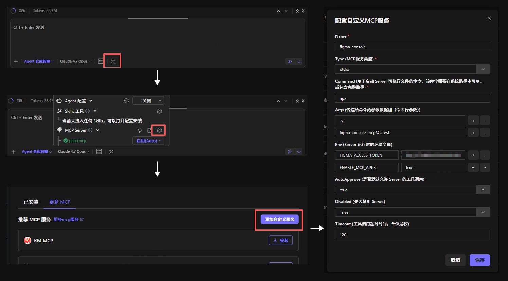

# 接收者上手指南

本目录是 `game-interaction-sop` 的源码分发包，解压后请按下列步骤启用。

## 前置要求

必须在对方电脑上已准备好：

| 项 | 最低版本 | 检查命令 |
|---|---|---|
| Node.js | ≥ 20 | `node -v` |
| Figma 桌面端 | 最新 | — |
| AI Agent | — | CodeMaker（仓库智聊） / Claude Desktop / Codex CLI / Cursor / Cline / … |

> **figma-console MCP 不用单独装**：图形界面 Agent（CodeMaker 等）走 `npx -y figma-console-mcp@latest` 在线拉，命令行 Agent 想离线的话本仓库 `vendor/figma-console-mcp-1.23.0.tgz` 也带了一份。

## 5 步启用

### 1. 解压并进入目录

```bash
# 解压后
cd game-interaction-sop
```

### 2. 安装依赖并编译

```bash
npm install
npm run build
```

期望输出：两个包（`@game-interaction-sop/engine`、`@game-interaction-sop/mcp-adapter`）都 tsc 通过，无报错。

### 3. 跑冒烟测试确认环境 OK

```bash
npm run test
npm run test-parse
```

期望看到：
- `test`: 69/69 通过（migration smoke + 46 engine + 23 adapter）
- `test-parse`: 解析 `examples/玩家等级系统/玩家等级系统_交互文档.md`，IR 列出 3 个 section、12 个 cluster，第 3 个标 `isGlobalSpec=true`

### 4. 把 figma-console MCP 配到你的 Agent

#### 4A · 图形界面 Agent（CodeMaker / 仓库智聊，**推荐**）

照下面这张图操作：输入框右上角扳手图标 → MCP Server 旁的齿轮 → 添加自定义服务，填表保存即可。



字段对照表（**完全照填**）：

| 字段 | 值 |
|---|---|
| Name | `figma-console` |
| Type | `stdio` |
| Command | `npx` |
| Args | 第一行 `-y`，第二行 `figma-console-mcp@latest` |
| Env | 一般留空。如要让 MCP 直接读 Figma 云文件再加 `FIGMA_ACCESS_TOKEN` |
| AutoApprove | `true`（让 SOP 全程不被打断） |
| Disabled | `false` |
| Timeout | `120` |

保存后 MCP Server 列表里 `figma-console` 应该是 ✅ 已启用状态，工具栏会出现 `figma_execute` 等工具。

#### 4B · 命令行 / IDE Agent（Codex / Claude / Cursor / Cline）

```bash
npm run install-mcp -- --agent codex     # 或 claude / cursor / cline
# 走 npm registry 的话加 --online；默认从 vendor/ 离线解包
```

脚本会：
1. 把 `figma-console-mcp` 解包到 `~/.game-interaction-sop/mcp/figma-console-mcp/`
2. 打印一段 **MCP 配置 snippet**——复制粘贴到你 agent 的 MCP 配置文件里（脚本会告诉你文件路径）
3. 提示你去 Figma 桌面端导入 `figma-desktop-bridge` 插件（一次性）

粘完 snippet 后重启 agent。

> 已经用别的方式装过 `figma-console-mcp` 的话本步可跳过。

### 5. 安装 skill 到你的 AI Agent

```bash
# 选一个对应你的 agent
npm run install-skill -- --agent codex
npm run install-skill -- --agent claude
npm run install-skill -- --agent cursor
npm run install-skill -- --agent cline
```

脚本会把 `packages/skill/` 的内容复制到对应 agent 的 skills 目录（例如 codex → `~/.codex/skills/game-interaction-sop/`）。

> CodeMaker 用户：在 CodeMaker 里点扳手图标 → Skills 工具 → 旁边的齿轮 → 选定本仓库的 `packages/skill/` 目录即可，无需运行 install-skill 脚本。

之后在你的 agent 里开新会话，就能调用这个 skill。

## 准备 Figma 模板

引擎代码里写死了模板文件 key `UYCJok3MXTWITMfeJSqEF6`。**你需要让分发者把模板文件复制到你的 Figma 账号下**（或者用共享权限）。

拿到模板文件后，用 AI Agent 跑流程时告诉它你要写入的 Figma 文件 URL 即可。

## 日常使用（典型流程）

```
用户（你）：
  用 game-interaction-sop 跑这个策划文档：[粘贴 docx 路径或内容]
  Figma 目标文件：[你的 Figma URL]

AI Agent：
  Stage 0  → 读策划文档，判断走快速路径（1A）还是 UX 共创路径（1B），公开理由请你确认
  Stage 1A/1B → 创建 _requirements.md 副本，确认阻塞问题（1B 还会过滤后给 UX 建议，需你点头才入）
  Stage 2  → 暂停等设计师在 Figma 出稿，告诉 Agent 设计稿的 node ID
  Stage 3  → Agent 扫描设计稿，把元素映射到需求，双向对话补齐 → _design-understanding.json
  Stage 4  → 合成 _requirements + _design-understanding，输出 v2 Markdown 给你审核保存
  Stage 5  → 调引擎写入 Figma（designUnderstanding 优先 / assetMap 回退）
```

Stage 5 期间，AI 会通过 figma-console MCP 插件操作 Figma，你可以在 Figma 里实时看到变化。

## 常见问题

### Q1. `npm install` 失败？

看一下 Node 版本。需要 ≥ 20。有 nvm 的话 `nvm use 20`。

### Q2. 测试过了，但 AI 不认识这个 skill？

- 确认 skill 装到正确 agent 了：`node scripts/install-skill.mjs --agent <你的 agent> --dry-run` 会打印目标路径
- 有些 agent 要重启会话才会发现新 skill

### Q3. Stage 5 报"桥超时"？

图片比较大时（>1MB）rasterize 可能触发 MCP 7s 超时。引擎已做优雅降级：主图位置保留占位，你自己在 Figma 里手动把图拖到占位矩形上盖住即可。详见 `packages/engine/docs/figma-mcp-pitfalls.md` Bug 15。

### Q4. 我想改代码？

- 改完 `packages/engine/src/**/*.ts` 或 `packages/mcp-adapter/src/**/*.ts` 后跑 `npm run build`
- 改 skill Markdown 后重跑 `node scripts/install-skill.mjs --agent <你的 agent> --force` 才会同步到 agent 目录

### Q5. figma-console MCP 装到哪了？怎么卸？

`install-mcp.mjs` 把 MCP 解包到 `~/.game-interaction-sop/mcp/figma-console-mcp/`（可通过 `npm run install-mcp -- --dry-run` 查看具体路径）。要卸载：

1. 删除该目录
2. 把当初粘到 agent config 里的 `figma-console` snippet 删掉
3. 如果不再用这份 SOP，顺手把 `~/.<agent>/skills/game-interaction-sop/` 也删了

## 目录结构速查

```
game-interaction-sop/
├── packages/
│   ├── engine/        → parser + renderer (TypeScript library)
│   ├── mcp-adapter/   → FigmaBackend 实现, 桥接 figma-console MCP
│   └── skill/         → AI agent 看的 SOP Markdown (SKILL.md + 4 phases)
├── scripts/
│   ├── install-skill.mjs   → 装 skill 到 agent
│   ├── install-mcp.mjs     → 装 figma-console MCP（离线/在线二选一）
│   ├── test-parse.mjs      → 验 parser
│   └── adapter-dry-run.mjs → 打印 adapter 会生成的 JS 脚本 (debug 用)
├── vendor/
│   └── figma-console-mcp-1.23.0.tgz   → 内置 MCP runtime, MIT
├── examples/
│   └── 玩家等级系统/  → 已跑通的参考输入
├── README.md          → 项目说明
├── SETUP.md           → 本文件
└── package.json
```

## 反馈

跑的过程中发现 bug / pitfalls / 不顺手的地方，直接联系分发者。请附上：
- 策划文档（或能复现的最小片段）
- AI Agent 的会话摘要（特别是 Stage 5 的错误信息）
- `packages/engine/docs/figma-mcp-pitfalls.md` 里有没有类似条目
